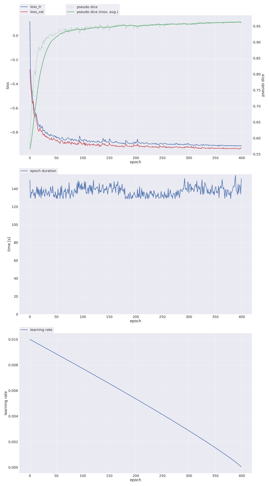

# AirRC pulmonary segmentation

三维肺动脉、肺静脉和气道腔分割实验。当前主线为 AirRC 单源 U-Mamba M0 训练，以及 PARSE2022 肺动脉外部评估。

## 实验状态

- AirRC M0 已完成 100,000 步，最佳权重来自第 400 个 epoch。
- AirRC 按患者固定为 178 例训练、38 例验证、38 例独立测试，seed 为 2026。
- PARSE2022 使用官方公开有标注的 100 例 train 子集作为本模型的外部评估数据。

## AirRC 结果

下表为患者级均值 ± 标准差。Dice 与 clDice 使用百分数，HD95 使用毫米。

| 数据划分 | 结构 | Dice（%） | clDice（%） | HD95（mm） |
|---|---|---:|---:|---:|
| 验证 | 肺动脉 | 96.32 ± 0.79 | 97.23 ± 1.05 | 1.01 ± 0.07 |
| 验证 | 肺静脉 | 96.53 ± 0.70 | 97.52 ± 1.10 | 1.01 ± 0.07 |
| 验证 | 气道腔 | 95.94 ± 2.10 | 94.45 ± 1.98 | 1.01 ± 0.07 |
| 测试 | 肺动脉 | 96.43 ± 0.43 | 97.43 ± 0.55 | 1.00 ± 0.00 |
| 测试 | 肺静脉 | 96.48 ± 0.91 | 97.59 ± 0.63 | 1.11 ± 0.66 |
| 测试 | 气道腔 | 95.29 ± 2.93 | 93.62 ± 2.66 | 1.04 ± 0.15 |

[逐例结果](reports/airrc_m0/per_case.csv) · [完整汇总](reports/airrc_m0/summary.json) · [400 个 epoch 训练记录](reports/airrc_m0/training_history.csv) · [50 次完整验证记录](reports/airrc_m0/validation_history.csv)

## 动静脉错分补充评价

已加入六项病例级动静脉指标、固定的 38 例验证/38 例测试队列及物理空间对齐流程。[指标公式和复用命令](docs/av_metrics.md)

当前 M0 的旧评估未保存预测标签，验证及测试各缺失 38 例，六项新增指标的有效病例数均为 0。缺失记为 NaN，尚无真实 AV 结果；未重新启动训练或推理。[补算状态与缺失清单](reports/airrc_m0/av_metrics/README.md)

## PARSE2022 外部测试

| 指标 | 肺动脉外部测试，100 例 |
|---|---:|
| Dice（%） | 80.67 ± 3.42 |
| IoU（%） | 67.74 ± 4.73 |
| Precision（%） | 73.14 ± 6.99 |
| Recall（%） | 90.97 ± 5.47 |
| clDice（%） | 79.15 ± 7.24 |
| HD95（mm） | 7.51 ± 3.61 |

[逐例结果](reports/parse2022/per_case.csv) · [完整汇总](reports/parse2022/summary.json)

PARSE2022 的目标标签为肺动脉。预测取 M0 原三类 argmax 输出中的类别 1，并恢复至原始 PARSE2022 标签网格计分。该实验的权重、归一化及推理设置由 AirRC 实验确定。[PARSE2022 数据说明](https://parse2022.grand-challenge.org/Dataset/)

## 最佳权重

下载 [v0.1.0 的 checkpoint_best.pth](https://github.com/cw462/airrc-pulmonary-segmentation/releases/download/v0.1.0/checkpoint_best.pth)。模型类别为背景 0、肺动脉 1、肺静脉 2、气道腔 3。模型目录结构见 [权重说明](weights/README.md)。

## 环境

实际运行环境为 Linux、Python 3.8.12、PyTorch 2.1.0、CUDA 12.1、Mamba 1.2.0.post1 和 RTX 3090 24 GB。[完整版本记录](configs/runtime_versions.json)

安装 U-Mamba 作者仓库所需的 nnU-Net 分支和 CUDA 算子，并将 UMAMBA_ROOT 指向其中包含 nnunetv2 的 umamba 目录。requirements-runtime.txt 记录本次核心 Python 包版本。[U-Mamba 安装说明](https://github.com/bowang-lab/U-Mamba)

~~~bash
export UMAMBA_ROOT=/path/to/U-Mamba/umamba
export RUN_ROOT=/path/to/airrc_experiment
export AIRRC_SOURCE=/path/to/AirRC
~~~

AirRC 输入目录需要一份病例对应 CSV，列名包含 PatientID、CT_mhd、CT_raw、AirRC_mask，图像与标签路径相对于输入根目录。源 CT 使用配套的 .mhd 和 .raw，标签为官方 NIfTI。该数据组织方式由 prepare_airrc.py 读取。

~~~bash
python prepare_airrc.py --source "$AIRRC_SOURCE" --cache "$RUN_ROOT/full/raw" --workers 4
CUDA_VISIBLE_DEVICES=0 bash scripts/run_m0.sh "$RUN_ROOT"

python prepare_airrc.py --source "$AIRRC_SOURCE" --cache "$RUN_ROOT/full/raw" --workers 4 --test
CUDA_VISIBLE_DEVICES=0 bash scripts/evaluate_airrc.sh "$RUN_ROOT"
~~~

使用同一 M0 进行 PARSE2022 外部评估。PARSE_SOURCE 下应为 PAxxxxxx/image/ 与 PAxxxxxx/label/ 的病例目录。

~~~bash
export PARSE_SOURCE=/path/to/PARSE2022/train
export PARSE_RUN=/path/to/parse_external
export MODEL="$RUN_ROOT/full/results/Dataset926_AirRC/AirRCTrainer__nnUNetPlans__3d_fullres"

python prepare_parse_manifest.py --source "$PARSE_SOURCE" --output "$PARSE_RUN/manifest.json" --airrc-summary "$RUN_ROOT/evaluation/results/summary.json"
bash scripts/evaluate_parse.sh "$PARSE_RUN/manifest.json" "$MODEL" "$PARSE_RUN/results" 0 1
~~~

图像和标签由数据提供方获取。实验定义、标签转换、实际优化器设置、评价口径及引用见 [实验协议](docs/experiment_protocol.md) 和 [第三方来源](THIRD_PARTY_NOTICES.md)。
